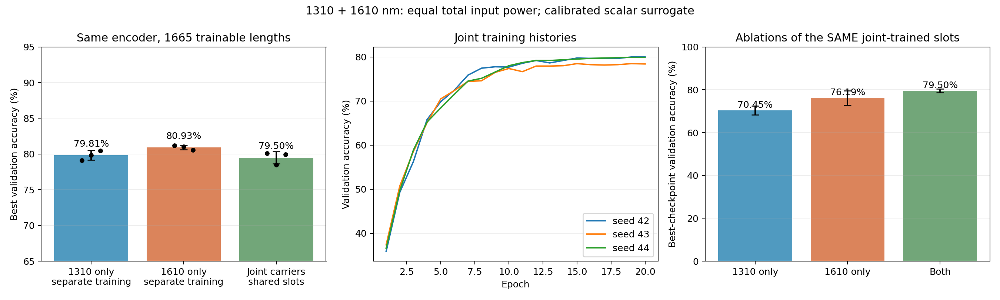
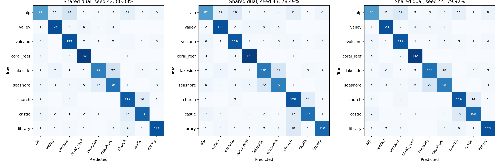

# 共享槽结构双波长联合九分类

日期：2026-10-19。该实验实际联合训练了一套共享槽长，同时利用 1310 nm、1610 nm 完成九分类。模型为局部电磁标定驱动的标量角谱代理，尚未进行完整器件 FDTD 或实物双波长验证。

## 联合方式

两个波长加载同一样本、相同的 16 维九类相位编码。在这个理想输入模型中，同一数值相位在两个载波上分别施加，未模拟共用移相器的波长相关驱动。两个分支共享一个 3×555 的槽长张量，共 1665 个可训练参数。各波长使用自己的有效折射率、槽复透射查表和传播算子。输入、输出模式沿用解析余弦模式。

各分支按单位输入功率计算 P_1310、P_1610，实际总输入功率固定为 1，各占 0.5。第 j 个端口的读出为 P_j = 0.5 P_1310,j + 0.5 P_1610,j，随后仅在前九个端口归一化，取最大者作为类别。不同光频率的复场不直接相加，不引入可训练电子分类器。假设慢速探测器平均掉载波拍频，且两波长探测响应相同；真实探测器的波长响应尚未标定。

同一套槽结构上的两个复传输矩阵均已保存。矩阵尺寸为 10×16，文件维度为“波长、输出、输入”，定义 b = T a。每步从 16 个输入基模式提取矩阵，再作用于样本；这利用线性叠加减少计算，预检查已与原逐样本传播核对端口功率及槽长梯度。

## 数据与训练

固定 7200 个训练样本、1260 个验证样本；九类各有 800/140 个样本。复用原正式九分类的训练集拟合编码 RBF384→LDA8+PCA8，两个载波接收同一份输入。未更换数据集，未重新选择特征；数据是合成可见光场景图，波长是计算载波。

种子：[42, 43, 44]。每次 20 轮，batch64，Adam lr=8e-4、weight_decay=1e-4，余弦最低学习率 3e-5，梯度裁剪 1，输入相位噪声 0.005π。槽长初始化 0.5±0.02 μm，限制在已标定的 0–2 μm。3 层、555 组/层、4 段 125 μm、500 μm 训练区域，10000 点、0.05 μm 网格，2 倍填充。最佳轮次按验证准确率优先、交叉熵次之选择。

## 实际结果

| 模型 | 最佳验证准确率，均值 ± 种子间样本标准差 |
| --- | --- |
| 单波长 1310 nm，原分别训练基线 | 79.81% ± 0.67 百分点 |
| 单波长 1610 nm，原分别训练基线 | 80.93% ± 0.33 百分点 |
| 双波长、共享槽长、联合训练 | 79.50% ± 0.87 百分点 |
| 两套独立槽结构的固定等功率输出求和，仅作参考 | 80.61% ± 0.18 百分点 |

联合训练相对原 1310 nm 基线的平均变化为 -0.317 百分点，相对原 1610 nm 为 -1.429 百分点。两套结构求和参考需要 3330 个槽长，未作为共享单器件结果；该参考复用已有单波长检查点，没有另行训练。

| 种子 | 联合最佳轮次 | 双波长 | 同一联合结构仅开 1310 nm | 同一联合结构仅开 1610 nm |
| --- | --- | --- | --- | --- |
| 42 | 20 | 80.08% | 68.25% | 77.22% |
| 43 | 19 | 78.49% | 72.38% | 78.89% |
| 44 | 20 | 79.92% | 70.71% | 72.46% |

联合模型最终轮次的平均准确率为 79.47% ± 0.92 百分点。分支消融不重新训练或重新选检查点；关掉另一路后观察分类准确率，不能据此推断噪声或信噪比优势。





## 检查与限制

- 所有种子用 20000 点复核；seed42 另用 4 倍填充复核。最大准确率绝对变化为 0.159 百分点，详见 convergence.json。
- 六个原单波长基线均在当前代码环境重算端口输出，与存档预测核对，准确率一致。
- 预检查验证两波长使用同一个 Parameter、只有 1665 个可训练量，两路对该参数均有有限非零梯度，且传播符合输入归一化与被动功率检查。
- 前九个端口的平均收光比例为 0.6634%，相对于固定总输入功率。归一化交叉熵不约束效率，准确率不能代表高收光效率，也未建模探测噪声。
- 同一验证集用于检查点选择；只有三个种子，没有独立测试集，不作普遍优越性或统计显著性断言。
- 本次是双波长共同九分类，没有规定一个波长粗分、另一个细分，也没有建立两级路由。
- 当前编码经监督降维，不保留原图二维空间坐标；当前数据未保证细分类只能依赖局部细节。
- 局部周期槽查表忽略非局部槽耦合、反射往返、角度依赖和真实端口色散，需进一步全器件验证。

## 复现与文件

在项目根目录运行：

```powershell
python comparison_1310_1610_scene3_20261016/run_joint_fine9.py
```

默认跑三个种子、20 轮，并输出检查和报告；同配置的已完成结果会跳过。`--analysis-only` 从已完成检查点重新验证并生成报告；`--preflight-only` 只运行物理和梯度检查。完整复现需恢复原数据集；小型检查点、编码和标定数据随仓库保存。

- config.json：运行参数、输入及代码 SHA256、软件版本。
- preflight.json：共享参数、功率、梯度及矩阵法等价性检查。
- seed*/best_model.pt、final_model.pt、slot_lengths_um.npy：共享槽长检查点。
- seed*/history.json、summary.json：逐轮训练和最佳结果。
- seed*/validation_predictions.npz：联合概率、端口功率、各波长单位输入功率下的读出、真值。
- seed*/complex_transfer_matrices.npz：同一物理槽结构下两个波长的 10×16 复传输矩阵。
- convergence.json、summary.json：数值复核、基线重现、对比结果。
