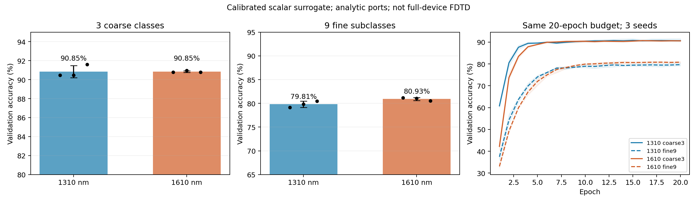
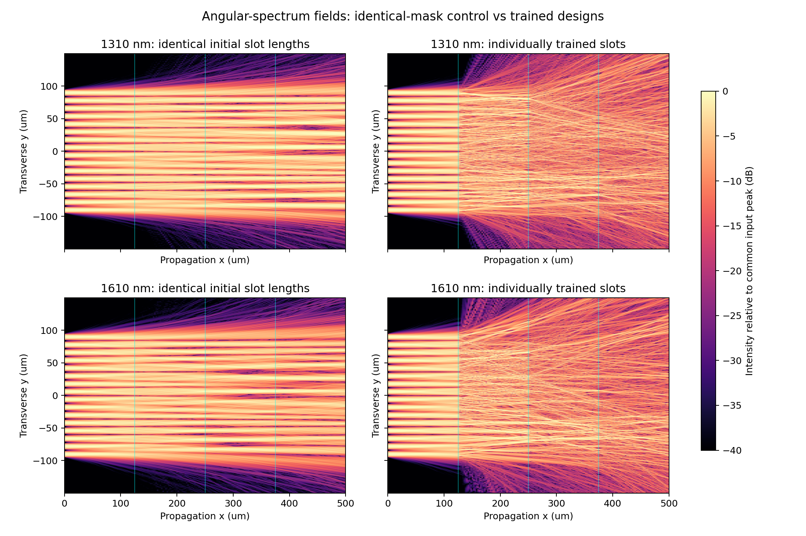
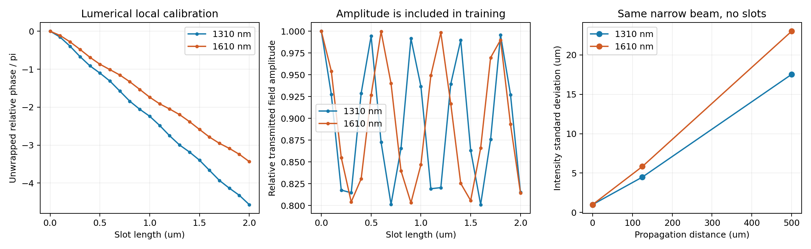
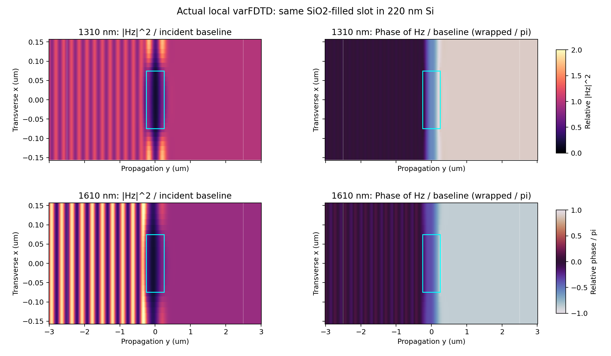

# 1310 nm / 1610 nm 衍射网络分类对照

本目录包含实际完成的训练及分析。结论仅针对**局部 Lumerical 标定驱动的标量角谱代理模型**，输入/输出为解析余弦孔径，尚未生成这两个波长的完整器件 FDTD 端口映射。原 1560 nm 项目未覆盖。

## 分类结果

训练集 7200，固定验证集 1260；每个模型训练 20 轮，3 个配对种子（42/43/44），共 12 次正式训练。下表为各次最佳验证模型的平均准确率 ± 种子间样本标准差；这是验证成绩，不是独立测试成绩。

|任务|1310 nm|1610 nm|
|---|---:|---:|
|三大类|90.85% ± 0.64 百分点|90.85% ± 0.09 百分点|
|九个细类|79.81% ± 0.67 百分点|80.93% ± 0.33 百分点|

三分类中 1610−1310 的平均差为 +0.000 百分点，3个配对种子中1610更高的有 2 个。

九分类中 1610−1310 的平均差为 +1.111 百分点，3个配对种子中1610更高的有 3 个。

三大类：自然地貌、水域/海岸、人造建筑。九细类：山地、山谷、火山、珊瑚礁、湖岸、海岸、教堂、城堡、图书馆。数据来自合成可见光图像；波长表示光计算载波，不表示红外成像波段。

粗分类使用原项目冻结的 16 维编码（LDA2+PCA14）。细分类使用同一组 568 维原始特征和相同样本划分，训练集拟合的 RBF384→LDA8+PCA8 编码为 16 个输入。两个波长使用相同编码；粗细任务间编码不同，不能把二者准确率直接相减来度量任务难度。

九分类还报告“已知真实大类后，在相应 3 个细类端口中取最大”的诊断准确率。该指标用了真实大类，不等于可部署级联系统的准确率；详见 summary.json。



## 几何与模型

保持 500 μm 横向宽度、4 段 125 μm 传播间距、16 输入、10 输出、3 层可训练槽。原 shape 文件中 1500 组独立槽长与 500 μm 宽度及 0.3 μm×3 重复的 0.9 μm 组间距冲突。本对照明确采用 555 组，每层覆盖 499.5 μm，两侧各留 0.25 μm。每组采用周期单元标定的有效薄屏透射，不显式解析组内 3 根槽边界。

1310/1610 nm 分别使用自己的 TE 有效折射率及复透射幅度、展开相位插值，槽长限定 0–2 μm，不外推。角谱法包含倏逝分量衰减；500 μm 区域用 10000 点（0.05 μm）采样，传播计算区域为 1000 μm（2 倍填充），全场在各间距之间保留，只有槽层覆盖中央区域。输入/输出分别是 10/12 μm 宽的归一化余弦孔径，不声称是实测或完整锥形波导模式。

随机初始槽长为 0.5±0.02 μm，各波长严格配对；Adam lr=8e-4，weight_decay=1e-4，余弦下降，batch64，梯度裁剪1，输入相位噪声0.005π。损失为活动端口归一化概率交叉熵，无可训练电子读出。三分类取前3端口，九分类取前9端口。

薄屏模型忽略不同槽之间的非局部耦合、反射往返、斜入射响应变化和真实端口频散。因此这些结果不能与旧 1560 nm 91.75% 直接比较，更不能替代完整器件验证。

## 传播差异

下图左列使用完全相同的输入和物理槽长，右列使用分别训练的槽长。只用左列归因于波长；右列还包含优化设计差异。以相同输入峰值归一化，颜色为强度 dB。



- 1310 nm：n_eff=2.982975，片上有效波长=0.439159 μm；传播空间频率截止=2.277 周期/μm。同一初始强度标准差 1 μm 的无槽高斯束，125 μm 后标准差 4.489 μm，500 μm 后 17.534 μm。
- 1610 nm：n_eff=2.795768，片上有效波长=0.575870 μm；传播空间频率截止=1.737 周期/μm。同一初始强度标准差 1 μm 的无槽高斯束，125 μm 后标准差 5.833 μm，500 μm 后 23.008 μm。

1610 nm 的片上有效波长约大 31%，同样的窄光束衍射展宽更明显。1310 nm 对单位槽长的相位变化更敏感：相位斜率约 −2.309π/μm，1610 nm 约 −1.738π/μm。相同 10 nm 长度误差对应约 0.0726 / 0.0546 rad 相位误差；这是相位灵敏度，不能单独代表总分类鲁棒性。实际复透射幅度也随槽长和波长变化。



编码后的 16 个特征通道不按原图空间坐标排列，且前几个特征经过监督判别降维。光场横向高空间频率不直接等于图像细节，因而不能单凭短波衍射小就推出短波更适合语义细分类。

## 数值验证及实用限制

- 全部12个最佳模型在 0.025 μm 网格复核；概率平均绝对变化最大 0.000466，准确率变化最大 0.159 百分点。
- seed42 的4个模型将填充从2倍增至4倍；概率平均绝对变化最大 0.001976，准确率变化最大 0.079 百分点。
- preflight.json 检查了输入能量归一、被动传播能量不增及非零有限梯度。slot_tolerance.json 是 seed42 上 5/10/20 nm 槽长随机扰动的3次重复诊断，未纳入再训练或模型选择。
- accuracy 使用活动端口内的归一化概率；优化没有约束收光效率。以下收光比例是解析标量模型相对输入功率的估算，不是实测器件效率：
  - coarse3, 1310 nm：活动端口平均收光 0.641%。
  - coarse3, 1610 nm：活动端口平均收光 1.027%。
  - fine9, 1310 nm：活动端口平均收光 0.553%。
  - fine9, 1610 nm：活动端口平均收光 0.744%。
- 两个波长分别优化了不同槽长，并非共享结构的双波长网络。跨波长沿用同一槽长的诊断见 cross_wavelength_same_mask.json。
- 固定验证集同时用于选择最佳轮次；只有3个种子，无独立测试集。配对 McNemar 结果见 summary.json，仅作探索，不把多种子预测当成独立新增验证样本。

## 关于粗分/细分的解释

应以分类对照判断当前系统中的适用性，并结合种子稳定性、数值误差及效率。即便某波长在九分类略好，也不能称为普适的‘细分波长’；孔径、传播距离、槽布局、输入编码、类别及训练预算均会改变排序。可检验的工程假设是 1610 nm 偏向更强空间混合、1310 nm 保留更高横向带宽；本实验并不预设这一假设会转化为长波粗分、短波细分。

若要实现级联任务，应另行联合训练共享槽结构或明确的两级网络：第一级给出三大类，第二级在预测大类内给出细类；以级联最终九类准确率、收光效率和串扰为联合指标，并比较两种波长分配。当前分别训练的模型及使用真实大类的诊断不足以证明该级联系统。

## 复现与文件

在项目根目录运行（Python环境需 torch、numpy、scipy、scikit-learn、joblib、matplotlib）：

```powershell
python comparison_1310_1610_scene3_20261016/run_comparison.py --tasks coarse3 fine9 --seeds 42 43 44
python comparison_1310_1610_scene3_20261016/analyze_comparison.py
```

已完成结果会跳过，不覆盖。正式结果在 resolved_grid10000/，其上级 coarse3/ 和 fine9/ 为早期0.10 μm网格的探索，不能混用。每次正式训练含 best/final_model.pt、槽长.npy、history.json、summary.json、validation_predictions.npz；本 analysis/ 保存全部图与分析 JSON。config.json 含数据与标定输入 SHA256。

## 细分诊断、槽长误差及同槽跨波长

已知真实大类时，九端口模型在相应三个细类内的诊断准确率（种子平均）：

|所属大类|1310 nm|1610 nm|
|---|---:|---:|
|natural_landform|85.00%|85.00%|
|water_coast|86.03%|86.51%|
|built_environment|88.17%|88.97%|

1310 nm：真实大类条件下的总体细分准确率 86.40%。

1610 nm：真实大类条件下的总体细分准确率 86.83%。

以下为 seed42 单独诊断，不与三种子正式均值混用：

|任务|波长|20 nm 槽长高斯误差的平均准确率，3次扰动|
|---|---:|---:|
|coarse3|1310 nm|89.39%|
|coarse3|1610 nm|89.47%|
|fine9|1310 nm|74.89%|
|fine9|1610 nm|79.68%|

|任务|槽长训练波长→测试波长|直接切换波长的准确率|
|---|---|---:|
|coarse3|1310→1610 nm|44.21%|
|coarse3|1610→1310 nm|34.21%|
|fine9|1310→1610 nm|31.51%|
|fine9|1610→1310 nm|16.59%|

同一槽长直接换波长的表现说明：分别训练成功不意味着一套槽版能承担两个波长的粗细分任务。共享器件需将两种波长的复响应同时纳入训练目标。
## 相同槽单元的实际 Lumerical 场图

local_slot_fields.py 额外实跑了两个波长的无槽基线和同一 0.15 μm 宽、0.5 μm 长的 SiO2 填充槽；横向周期 0.3 μm，220 nm Si，其他参数与标定一致。这里的槽是周期阵列的一个单元，不是横向孤立槽。保存了原始 Hz 复场、求解器工程和日志。



场图左侧为相对无槽入射基线归一化的 |Hz|²，右侧为相对无槽复场的包裹相位；青框为槽边界。入射侧存在反射叠加，不能用该侧总场当每次的入射功率。局部 |Hz|² 是场分量诊断，不是器件透过功率。

- 1310 nm：0.5 μm 槽的相对透射幅度 0.994475，沿槽长扫描展开后的相对相位 -1.102948π；与原标定幅度/相位差 0.00e+00/-0.00e+00π。
- 1610 nm：0.5 μm 槽的相对透射幅度 0.926602，沿槽长扫描展开后的相对相位 -0.869691π；与原标定幅度/相位差 0.00e+00/-0.00e+00π。

该图直接显示相同槽结构中的局部场差异；它并不使前述网络代理模型成为完整器件 FDTD。